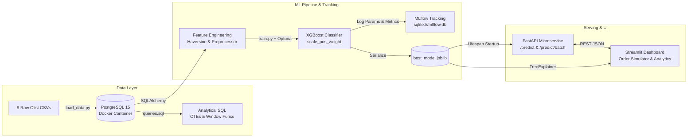

# 📦 Olist E-Commerce Delivery Delay Prediction Platform

An end-to-end, production-style machine learning platform that predicts whether a Brazilian e-commerce order will be delivered after its estimated delivery date at the exact moment of checkout. Built on the **Olist Public Dataset** (9 relational tables, 110,189 delivered items), this system integrates a **PostgreSQL** data layer, a **scikit-learn / XGBoost** feature engineering and modeling pipeline tracked with **MLflow**, a **FastAPI** inference microservice, and an interactive **Streamlit** dashboard with real-time **SHAP** explainability.

---

## 🎯 Problem Statement & Business Impact
Late deliveries are one of the primary drivers of customer churn and 1-star product reviews in e-commerce. In the Olist marketplace, **7.91%** of delivered items miss their estimated delivery date, with regional delay rates exceeding **19%–23%** in northeastern Brazilian states. 

Standard post-purchase tracking only alerts customers *after* a carrier bottleneck has already occurred. This platform predicts delay probability **at order placement**—strictly avoiding future data leakage—enabling logistics teams to proactively adjust promised delivery windows, reroute high-risk shipments, or flag orders for priority fulfillment.

---

## 🏗️ System Architecture



---

## ⚡ Quickstart Setup (3 Commands)

**1. Clone the repository, install dependencies, and spin up PostgreSQL:**
```bash
git clone [https://github.com/varshi-b/olist-delay-prediction.git](https://github.com/varshi-b/olist-delay-prediction.git) && cd olist-delay-prediction
pip install -r requirements.txt && cp .env.example .env && docker compose up -d
```

**2. Ingest the 9 Olist Kaggle CSVs (placed in `data/raw/`) and train the ML pipeline:**
```bash
python -m src.data.load_data && python -m src.models.train
```

**3. Launch the FastAPI backend and Streamlit dashboard:**
```bash
uvicorn api.main:app --port 8000 & streamlit run dashboard/app.py
```

---

## 📊 Model Evaluation & Results

All models were trained and evaluated on **109,635** valid delivered records (80/20 stratified split, **7.90%** positive delay class ratio) using zero post-purchase features to prevent data leakage. Class imbalance (~1:11.65) was addressed using `class_weight="balanced"` for linear/tree baselines and `scale_pos_weight=11.66` with **Optuna** hyperparameter tuning for XGBoost.

| Model | Imbalance Strategy | Precision | Recall | F1-Score | ROC-AUC | PR-AUC |
| :--- | :--- | :---: | :---: | :---: | :---: | :---: |
| **Logistic Regression (Baseline)** | `class_weight='balanced'` | 0.1296 | 0.5358 | 0.2087 | 0.6468 | 0.1332 |
| **Random Forest (`max_depth=12`)** | `class_weight='balanced'` | 0.2059 | 0.5150 | 0.2941 | 0.7530 | 0.2445 |
| **XGBoost (Optuna Tuned)** | `scale_pos_weight=11.66` | **0.2022** | **0.6207** | **0.3050** | **0.7712** | **0.2652** |

### Why XGBoost Was Chosen for Production
* **Superior Discrimination:** XGBoost achieved the highest **ROC-AUC (0.7712)** and **PR-AUC (0.2652)**—early-warning metrics critical for imbalanced classification where the baseline positive rate is only 7.90%.
* **High Recall for Risk Mitigation:** By capturing **62.07%** of all delayed orders at the default 0.50 threshold, operations teams catch nearly two-thirds of late shipments at checkout while maintaining fast inference latency (<15ms per request) and native compatibility with `shap.TreeExplainer`.

---

## 🛠️ Tech Stack & Repository Structure

* **Data & Database:** Python 3.11+, pandas, NumPy, PostgreSQL 15 (Docker), SQLAlchemy 2.0
* **Machine Learning & Explainability:** scikit-learn, XGBoost, Optuna, imbalanced-learn, SHAP, MLflow
* **API & UI:** FastAPI, Pydantic v2, Uvicorn, Streamlit, Plotly, Matplotlib/Seaborn
* **DevOps & Testing:** pytest, httpx (`ASGITransport`), Docker (multi-stage build), GitHub Actions CI

```text
olist-delay-prediction/
├── .github/workflows/ci.yml   # Automated pytest & Docker build pipeline
├── api/main.py                # FastAPI microservice (/predict, /predict/batch, /health)
├── dashboard/app.py           # Streamlit UI with SHAP waterfall explanations
├── docker/Dockerfile          # Multi-stage production Dockerfile
├── models/best_model.joblib   # Serialized preprocessor + tuned XGBoost pipeline
├── notebooks/01_eda.ipynb     # Exploratory data analysis & 6 diagnostic plots
├── src/
│   ├── data/                  # DB connection, CSV loader, and 9 analytical SQL queries
│   ├── features/              # Custom Haversine & temporal scikit-learn transformers
│   └── models/                # Optuna tuning & MLflow experiment logging
└── tests/                     # Unit & async API integration tests
```

---

## ⚠️ Limitations & Future Work

* **Limitations:**
  * **External Weather & Traffic Blindness:** The dataset lacks real-time weather anomalies, carrier strike events (such as the May 2018 Brazilian truckers' strike), and highway traffic data, which caps maximum achievable precision using checkout-only features.
  * **ZIP Code Centroid Approximation:** Haversine distance is computed between 5-digit ZIP code prefix centroids (`geolocation_zip_code_prefix`) rather than exact street-level routing distances.
* **Future Work:**
  * **Decision Threshold Optimization:** Tune the classification probability threshold based on asymmetric business costs (e.g., cost of a shipping voucher vs. cost of customer churn).
  * **Point-in-Time Historical Seller Features:** Expand the feature store to compute rolling 30-day seller fulfillment lag and carrier route congestion metrics using time-windowed SQL aggregations.
  * **Automated Data Drift Monitoring:** Integrate Evidently AI to monitor shifts in regional order volume and freight ratios over time.
